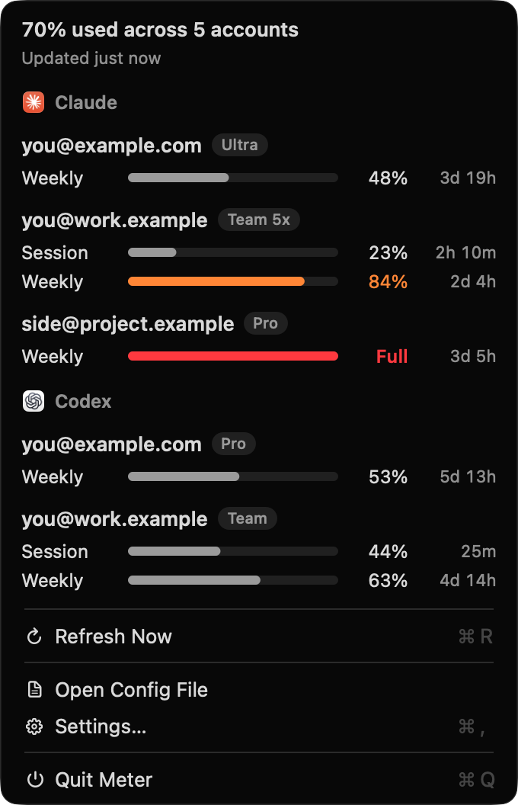

# meter

Plan usage limits across all your
[Claude Code](https://claude.com/claude-code) and
[Codex](https://github.com/openai/codex) accounts, in your Mac's menu bar.

<p align="center">
  
</p>

Meter sits in the menu bar as a gauge that fills with your overall usage.
Click it to see every account:

- One section per provider, with one row per account and its plan (Ultra,
  Max 5x, Pro, Team).
- Each limit (session, weekly) on one line: how much is used and when it
  resets, lined up so accounts compare at a glance. Bars turn orange at 75%
  and red at 90%; a maxed-out limit says "Full".
- Refreshes on a timer and on demand, without tripping the usage
  endpoints' rate limits.
- Refreshes expired sign-ins and saves them back, so the `claude` and
  `codex` CLIs keep working.
- Signed-out accounts get a "Log In…" item that opens Terminal with the
  right login command.

Prefer the terminal? There's also a btop-style
[terminal dashboard](#terminal-dashboard) that reads the same config.

## Install

Meter needs macOS 15 or later and Xcode (for the Swift toolchain).

```sh
git clone https://github.com/andybons/meter.git
cd meter/macos
make install
```

This builds Meter, copies it to /Applications and starts it. To start it
automatically, open Settings from its menu (⌘,) and turn on **Open at
Login**; macOS may ask you to allow it in System Settings.

## Set up your accounts

Each account needs its own config dir, set with `CLAUDE_CONFIG_DIR` (Claude
Code) or `CODEX_HOME` (Codex). The default `~/.claude` and `~/.codex` count
as one account each.

To add an account, pick a dir and log in once:

```sh
CLAUDE_CONFIG_DIR=$HOME/.claude-you@work.example claude auth login
CODEX_HOME=$HOME/.codex-you@work.example codex login
```

Then list your accounts in `~/.config/meter/config.toml`. Choose **Open
Config File** from Meter's menu to create and open it:

```toml
refresh = "2m"   # optional: 30s, 1m, 2m, 5m or 10m

[[claude]]
email = "you@example.com"            # no dir: the default ~/.claude

[[claude]]
email = "you@work.example"
dir   = "~/.claude-you@work.example"

[[codex]]
email = "you@example.com"            # no dir: the default ~/.codex
```

`email` is the label shown for the account. `dir` must be absolute or start
with `~/`. Use the same path you pass as `CLAUDE_CONFIG_DIR`, because Claude
Code names its Keychain entry after it. Meter picks up changes on its next
refresh.

With the terminal dashboard installed, `meter -init` writes this file for
you from the logins it finds (`~/.claude`, `~/.codex`, and any `~/.claude-*`
or `~/.codex-*` dir).

## Terminal dashboard

The same information as a btop-style terminal UI, for when you'd rather
stay in the terminal or aren't on a Mac.

```
╭─┐¹claude┌──────────────────────────────────────────────┐10:21:42┌╮
│▶ ● you@example.com                                ultra  now │
│    Weekly         ■■■■■■■■■■■■■■■■■■■■■■■■■   61% ↻ 1d 4h    │
│                                                              │
│  ● you@work.example                             team 5x  now │
│    Session        ■■■■■■■■■■■■■■■■■■■■■■■■■  100% ↻ 1h 24m   │
│    Weekly         ■■■■■■■■■■■■■■■■■■■■■■■■■   28% ↻ 5d 12h   │
╰─┐↑ select ↓┌┐login┌┐refresh┌─────────────────────────────────╯
```

```sh
go install github.com/andybons/meter@latest
meter                       # uses ~/.config/meter/config.toml
meter -config path.toml
meter -every 30s            # override the refresh interval
```

On Linux, Claude Code credentials are read from `.credentials.json` in the
config dir instead of the Keychain.

| Key | Action |
|---|---|
| `↑/↓`, `j/k` | select account |
| `1` / `2` | jump to the Claude / Codex panel |
| `r` | refresh all now |
| `enter` | refresh the selected account, or log in if it's signed out |
| `l` | log in to the selected account |
| `-` / `+` | change the refresh interval |
| `q` | quit |

## How it works

- **Claude**: reads the credentials Claude Code stores in the Keychain
  (`Claude Code-credentials`, with a `-<sha256(dir)[:8]>` suffix for custom
  dirs) and calls `api.anthropic.com/api/oauth/usage`.
- **Keychain**: both versions read and write it through `/usr/bin/security`,
  which Claude Code's entries already trust, so there's no password prompt
  per account.
- **Codex**: reads `<dir>/auth.json` and calls
  `chatgpt.com/backend-api/wham/usage`. Logins started from meter set
  `cli_auth_credentials_store="file"` so the file exists.
- **Tokens**: refresh tokens rotate on use, so refreshed tokens are written
  back to where the CLI reads them. If the CLI refreshed at the same time,
  meter uses the CLI's newer token instead.
- **Rate limits**: each Claude account is asked at most every 2 minutes and
  each Codex account every 30 seconds, requests to one host are spaced
  apart, and a 429 response's `Retry-After` is honored while the last
  numbers stay on screen.
- **Login**: runs with `ANTHROPIC_API_KEY` and `OPENAI_API_KEY` removed so
  you sign in with your subscription, not API billing.

Both usage endpoints are undocumented and may change without notice.

## Development

The Mac app is a Swift package in `macos/`: `MeterCore` holds the config,
credentials, fetching and display logic with no AppKit, and has the tests;
`MeterUI` is the AppKit menu, views and Settings; `Meter` wires them
together.

| Command (in `macos/`) | Does |
|---|---|
| `make` | format, then check |
| `make check` | lint, strict build and tests |
| `make app` | build `.build/Meter.app`, including its icon |
| `make run` | build and open the app from `.build` |
| `make install` | build, copy to /Applications and start |

`open .build/Meter.app --args --demo` shows sample accounts instead of
yours, without reading any config, credentials or network; that's how the
screenshot above was made.

The terminal dashboard is the Go module at the repository root:
`go test ./...`.

## License

MIT. See [LICENSE](LICENSE).
